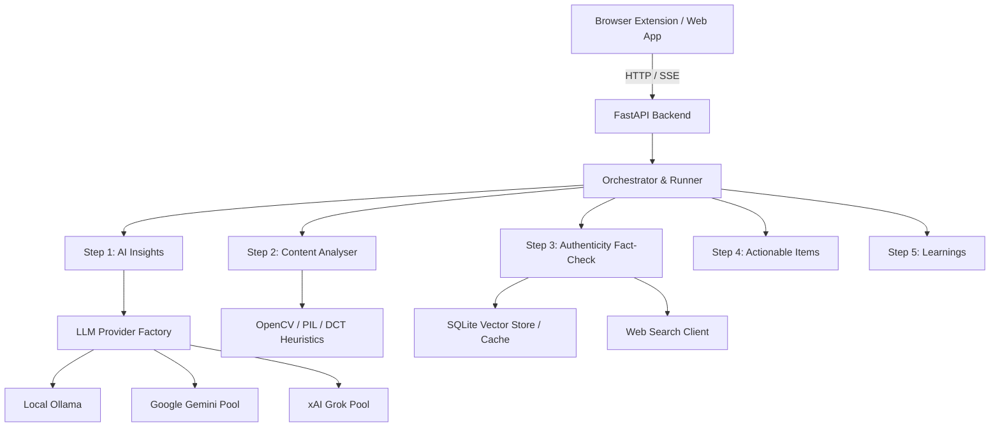

# UsisAIn Architecture

## Overview
UsisAIn is a local-first fraud, scam, and misinformation detection system. It provides real-time verification across text, image, and video content with zero data leakage by default.

## Layers and Responsibilities

### 1. Backend API (`backend-api/src/usisain_backend/`)
- `app_factory.py`: `create_app()` factory managing application lifespan, CORS middleware, and static asset mounting.
- `main.py`: Application entry point exporting `app` for Uvicorn and CLI runners.
- `api/`: Route handlers organized by domain:
  - `analyze.py`: Synchronous full-scan analysis endpoint (`/api/analyze`).
  - `stream.py`: Real-time SSE pipeline streaming endpoint (`/api/analyze/stream`).
  - `scans.py`: Scan history and aggregate statistics endpoints (`/api/scans`).
  - `settings.py`: AI provider switches, model lists, and test ping endpoints (`/api/settings`).
  - `reference_docs.py`: RAG reference document management endpoints (`/api/reference-documents`).
  - `errors.py`: Error log querying and clearing endpoints (`/api/errors`).
  - `tts.py`: Speech synthesis playback endpoints (`/api/tts`).
- `services/`: Encapsulated domain business logic used by routes via FastAPI `Depends`.
- `data/repositories/`: SQLite data persistence layer with context-managed database connections.
- `core/config.py`: Centralized configuration via `pydantic_settings.BaseSettings` with runtime `.env` synchronization.
- `orchestration/`: Pipeline execution engine:
  - `step_runner.py`: Executes individual steps with timeout and error trapping.
  - `event_formatter.py`: Transforms step outcomes into typed Server-Sent Events.
  - `aggregator.py`: Assembles individual step events into unified response payloads.
  - `pipeline.py`: Coordinates end-to-end multi-step analysis execution.

### 2. MCP Server & Pipeline (`mcp_server/`)
- `steps/`: Strongly typed modular implementations of the 5 analysis steps:
  - `step1/`: Initial text and visual content summarization and urgency detection.
  - `step2/`: Digital image and video forensics (ELA, DCT frequency noise, EXIF metadata, frame sampling).
  - `step3/`: Fact-checking synthesis, query generation, RAG cache lookup, and Google web search.
  - `step4/`: Personalized security checklists with privacy guards against personal handles.
  - `step5/`: Digital literacy resources and programmatic official link attachment.
- `prompts/`: Byte-for-byte isolated LLM prompt definitions.
- `services/llm/`: Uniform provider abstraction (`BaseLLMProvider`, `OllamaProvider`, `GeminiProvider`, `GrokProvider`, `FallbackProvider`, `KeyPool`).
- `constants.py`: Centralized threshold values, scoring weights, and defaults.

### 3. Client (`client/`)
- `web-app/`: Vanilla ES module dashboard and manual analysis interface (`/app` and `/app/dashboard`).
- `browser-extension/`: Manifest v3 browser extension enabling right-click page and snip analysis.
- `shared/`: Common API client, SSE streaming consumer, TTS player, and shared stylesheet.

## Data Flow

1. An analysis request arrives at `/api/analyze` or `/api/analyze/stream` with text, image, or video input.
2. The orchestrator invokes Step 1 to produce a foundational AI insight.
3. If visual media is supplied, Step 2 runs local forensics without external network calls; if text-only, Step 2 is marked not applicable.
4. Step 3 checks the local SQLite RAG store for cached investigations, queries Google/DuckDuckGo web search, and scores source reliability.
5. Step 4 distills earlier findings into concrete defensive recommendations while enforcing privacy rules.
6. Step 5 generates threat explanations and appends educational resources.
7. Results are stored in `data/app.db` and streamed or returned to the client.
